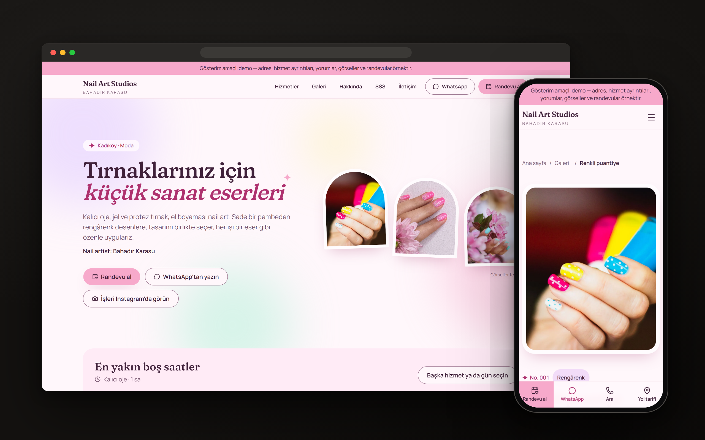
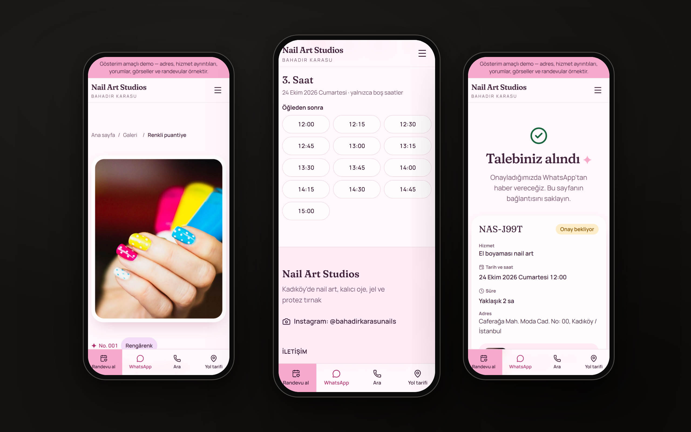
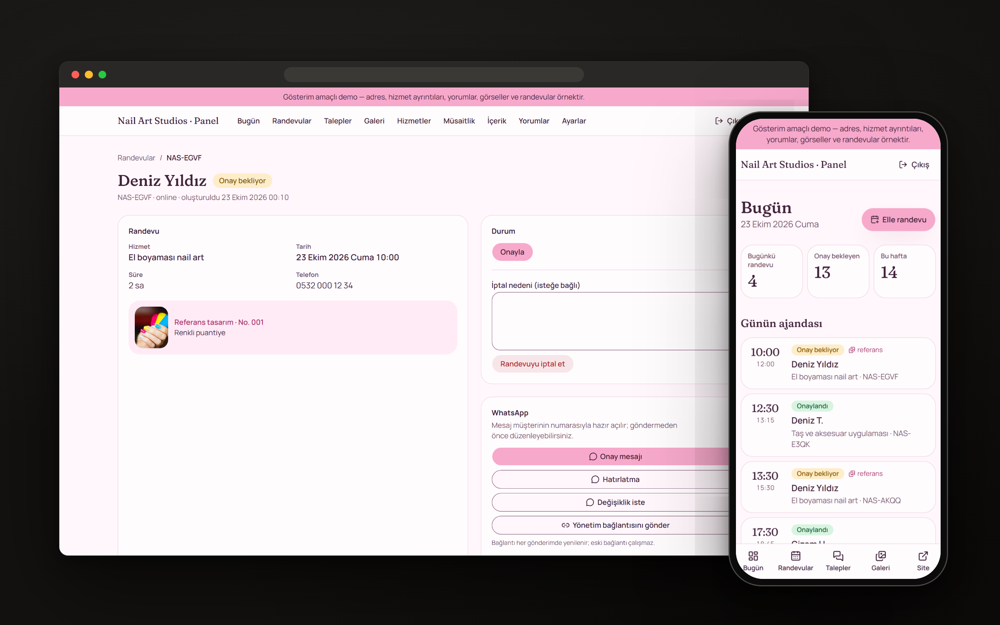

# Nail Art Studios · Bahadır Karasu

Kadıköy'de Bahadır Karasu'nun işlettiği nail art stüdyosu için mobil öncelikli web sitesi ve yönetim paneli. İşler galeri gibi sergilenir; ziyaretçi beğendiği tasarımdan gerçek müsaitliğe göre online randevuya ve WhatsApp'a geçer.

> **Kişiye özel demo.** İşletmeci adı, Instagram hesabı (@bahadirkarasunails) ve telefon / WhatsApp hattı (0542 311 58 88) gerçektir; adres, hizmet ayrıntıları, yorumlar, görseller ve randevu kayıtları örnektir. Site `DEMO_MODE=true` ile arama motorlarına kapalıdır ve dışarıya e-posta / mesaj göndermez.

**Canlı demo:** https://nail-art-studio-sigma.vercel.app · **Portfolyo metinleri:** [portfolyo/portfolyo.md](portfolyo/portfolyo.md)



## Öne çıkanlar

- **Numaralı galeri + "Bu tasarımı istiyorum":** randevu o tasarım ve ilgili hizmetle açılır.
- **Canlı müsaitlik:** ana sayfada en yakın boş saatler; randevuda yalnızca boş gün ve saatler. Çakışmayı PostgreSQL dışlama kısıtı engeller.
- **Yönetim bağlantısı:** müşteri randevusunu erteler, iptal eder, takvimine ekler (.ics, Google).
- **Telefon paneli:** Bugün, randevular, müsaitlik, galeri yükleme, hizmetler, içerik, yorumlar, onay kayıtları, ayarlar; WhatsApp şablonları.
- **Kalite:** 280 birim / entegrasyon + 367 uçtan uca test; her sayfa 6 genişlikte taşma ve axe denetiminden geçer; Lighthouse CI bütçeleri.

| Akış | Panel |
|---|---|
|  |  |

| | |
|---|---|
| Plan (tek doğru kaynak) | [docs/proje-plani.md](docs/proje-plani.md) |
| İlerleme ve sıradaki dilim | [docs/ilerleme.md](docs/ilerleme.md) |
| Araştırma | [docs/arastirma.md](docs/arastirma.md) |
| Kalite kapıları | [docs/kalite-kapilari.md](docs/kalite-kapilari.md) (rapor: ilerleme dosyasında) |
| Yönetim paneli kılavuzu | [docs/admin-kilavuzu.md](docs/admin-kilavuzu.md) |
| Yapay zekâ asistanı talimatları | [AGENTS.md](AGENTS.md) |
| Sistem | web-proje 1.0.0 · S2 · hesap modeli B · V1 |

## Yığın

Next.js 16.4 (App Router, Cache Components) · TypeScript 6 strict · Tailwind CSS 4 · PostgreSQL 17 (yerelde Docker, canlıda Neon) · Drizzle ORM · Zod 4 · Better Auth · Vitest · Playwright · pnpm 12 · Vercel.

## Kurulum

Gerekenler: Node 24 (`.nvmrc`), pnpm 12, Docker Desktop, [gitleaks](https://github.com/gitleaks/gitleaks) (commit kancası için).

```bash
pnpm install                     # kancaları da kurar (lefthook)
cp .env.example .env.local       # BETTER_AUTH_SECRET, IP_HASH_SALT, CRON_SECRET, DEMO_ADMIN_PASSWORD doldur
docker compose up -d             # PostgreSQL → localhost:5434 (app, testler için app_test)
pnpm db:migrate && pnpm db:seed  # tablolar + demo verisi + demo yönetici
pnpm dev                         # http://localhost:3000
```

Rastgele değer üretmek için: `openssl rand -base64 32` (auth sırrı), `openssl rand -hex 16` (IP tuzu). Demo yönetici şifresi en az 15 karakter olmalıdır.

**Panel:** `/panel` → `DEMO_ADMIN_EMAIL` ve `DEMO_ADMIN_PASSWORD` ile giriş. Demo modunda gönderilecek bildirimler `/panel/demo-kutusu`'nda görünür.

## Komutlar

| Komut | Ne yapar |
|---|---|
| `pnpm dev` / `pnpm build` / `pnpm start` | Geliştirme sunucusu / üretim derlemesi / üretim sunucusu |
| `pnpm check` | lint + typecheck + biçim + birim testleri (CI'ın e2e dışındaki tamamı) |
| `pnpm test` | Vitest: birim + entegrasyon (gerçek PostgreSQL `app_test`, `.env.test`; Docker açık olmalı) |
| `pnpm test:e2e` | Playwright: mobil + masaüstü, mobil taşma, dokunma hedefi, axe, panel girişi |
| `pnpm db:generate` / `pnpm db:migrate` | Migration üret (SQL'i okuyun) / uygula |
| `pnpm db:seed` / `pnpm db:reset` | Demo verisini yükle / şemayı sıfırla ve yeniden yükle (yalnızca demo) |
| `pnpm auth:generate` | Better Auth tablolarını yeniden üret |
| `pnpm analyze` | Paket boyutu analizi |
| `pnpm screenshots` / `pnpm mockup` | Portfolyo ekran görüntüleri / cihaz mockup'ları |
| `pnpm tsx scripts/generate-icons.ts` | `src/app/icon.svg`'den PNG ikonları üretir |
| `pnpm tsx scripts/images/build-demo-images.ts <klasör>` | Demo görsellerini `public/demo/` altına 480 / 960 / 1600 WebP olarak üretir (kaynaklar ve lisanslar: [docs/gorsel-kaynaklari.md](docs/gorsel-kaynaklari.md)) |

## Ortam değişkenleri

Hepsi açılışta `src/lib/env.ts` ile doğrulanır; açıklamalar `.env.example` içindedir. `DEMO_MODE=false` olduğunda `RESEND_API_KEY` ve `EMAIL_FROM` zorunlu olur, `DEMO_ADMIN_*` boş olmalıdır.

## Çalışma düzeni

- Dal: `{tür}/{kimlik}-{açıklama}`; `main`'e doğrudan push kancayla engellidir; PR + squash.
- Commit: Conventional Commits, İngilizce, `Refs: REQ-…, BR-…` alt bilgisiyle.
- Her dilim veri + sunucu + ekran (önce 360 px) + panel + test ile birlikte biter ([AKIŞ](docs/standartlar/README.md)).

## Yayın

Vercel (fonksiyon bölgesi `fra1`) + Neon. `vercel-build` betiği yayından önce migration'ları uygular. Demo'dan canlıya geçiş listesi: [docs/standartlar/16-ortamlar-ve-yayin.md](docs/standartlar/16-ortamlar-ve-yayin.md) ve plan §19.
