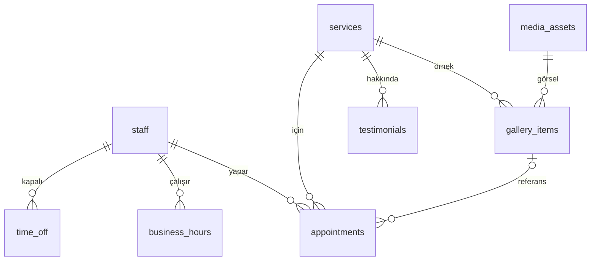

# Proje Planı — Nail Art Studios · Bahadır Karasu

| Alan | Bilgi |
|---|---|
| Belge sürümü | v0.2 |
| Tarih | 2026-10-16 |
| Durum | Onaylandı · Geliştiriliyor |
| Kapsam seviyesi | S2 Kurumsal+ ([§2](#2-kapsam-seviyesi)) |
| Hesap modeli | B: misafir işlem ([§8](#8-hesap-ve-yetki-modeli)) |
| Teknoloji varyantı | V1 ([§10](#10-teknoloji-ve-mimari-kararlar)) |
| Ortam | Demo (kişiye özel; gerçek ad, Instagram ve telefon, geri kalanı kurgusal) |
| Yayın | Önizleme: Vercel, `nail-art-studio-*-talha-keskin.vercel.app` (Vercel girişiyle korumalı) · Üretim (demo): Faz 6 |
| Kaynak kod | [github.com/htalhakeskin-lgtm/nail-art-studio](https://github.com/htalhakeskin-lgtm/nail-art-studio) (gizli) |
| Sistem sürümü | web-proje 1.0.0 |

> **Güncel durum:** Faz 3 (kurulum) yapıldı: iskelet, temel tablolar, site kabuğu, yasal sayfalar, panel girişi ve demo kutusu çalışıyor; birim ve e2e testleri yeşil. Sıradaki dilim D-01 (tasarım sistemi + çekirdek sayfalar).

---

## İçindekiler
1. Proje özeti ve hedefler · 2. Kapsam seviyesi · 3. Hedef kitle ve roller · 4. Araştırma özeti ve varsayımlar · 5. Özellik listesi · 6. Site haritası ve ekranlar · 7. Kullanıcı akışları · 8. Hesap ve yetki modeli · 9. Veri modeli ve iş kuralları · 10. Teknoloji ve mimari kararlar · 11. Tasarım yönü · 12. Yönetim paneli · 13. CRM ve süreç yapısı · 14. Yasal ve içerik gereklilikleri · 15. SEO planı · 16. Güvenlik, performans, erişilebilirlik hedefleri · 17. Entegrasyonlar · 18. Test planı ve kalite kapıları · 19. Demo verisi ve canlıya geçiş · 20. Yayın ve operasyon · 21. Portfolyo planı · 22. Kapsam dışı, riskler, açık sorular · 23. İlerleme ve karar günlüğü

---

## 1. Proje özeti ve hedefler

**Tek cümle:** Kadıköy'de Bahadır Karasu'nun işlettiği nail art stüdyosu için, işleri bir sanat galerisi gibi sergileyen ve ziyaretçiyi gördüğü tasarımdan birkaç dokunuşta gerçek müsaitliğe göre randevuya ve WhatsApp'a taşıyan, mobil öncelikli site + yönetim paneli.

**Vizyon:** Ziyaretçi Instagram'dan gelir, galeride beğendiği işi açar, öncesi / sonrasını görür, "Bu tasarımı istiyorum" der, boş saati seçip randevusunu alır ve WhatsApp'tan teyit eder. Bahadır Karasu telefonundan günün ajandasını görür, randevuyu onaylar, tek dokunuşla şablonlu WhatsApp mesajı gönderir, galeriye yeni iş ekler.

| Hedef | Ölçüt | Hedef değer |
|---|---|---|
| Randevu üretmek | Online randevu + WhatsApp + telefon tıklaması / ay | Demo'da ölçüm altyapısı; canlıda ilk ay baz alınır |
| Galeriden dönüşüm | "Bu tasarımı istiyorum" → tamamlanan randevu oranı | Olay olarak ölçülür (G-18) |
| Görünürlük | "kadıköy kalıcı oje", "moda nail art" kümeleri | Canlıya geçişte; demo `noindex` |
| Kalite | Lighthouse mobil | Performans ≥ 90, Erişilebilirlik ≥ 95, En iyi uygulamalar ≥ 95, SEO = 100 (`noindex` dışında) |

## 2. Kapsam seviyesi

| Kilit sinyal | Var mı | Kanıt |
|---|---|---|
| Online ödeme / sepet | Hayır | Fiyat bile gösterilmiyor; kapora yok |
| Zorunlu hesapla kişisel veri işleyen uygulama | Hayır | Model B |
| Çok kiracılı yapı | Hayır | Tek işletme |
| Filtreli katalog ≥ 20 kayıt | Hayır | Galeri 18–24 öğe filtreli ama ilan / ürün kataloğu değil; sayfalama ve filtre SEO paketi gerekmiyor |
| Çok kaynaklı müsaitlik | **Hayır** | Tek uzman (VR-02). İkinci uzman eklenirse S3'e çıkar |
| CRM / birden fazla personel rolü | Hayır | Tek yönetici |
| ≥ 3 etkileşimli araç | Hayır | Öncesi / sonrası kaydırıcısı tek araç |
| > 5 sayfa, form, tek kaynaklı randevu, içerik yönetimi | **Evet** | 13 herkese açık sayfa, randevu, panel |

**Seviye:** S2 · **Gerekçe:** En yüksek eşleşen sinyal "tek kaynaklı randevu + içerik yönetimi". Düzeltici yok. · **Zaman kutusu:** 1–3 odaklı gün (P0) · **Efor bütçesi:** 30 puan (çekirdek [Z] ve iskeletle gelenler hariç, K-09).

**Bütçe durumu:** P0 = 29 puan (bütçe içinde). P1 = 15 puan → toplam 44 puan, bütçenin ~1,5 katı (≈ 4–5 odaklı gün). P1'in eklenmesi **onaya bağlıdır** (K-10). Onay verilmezse P1 satırları P2'ye iner, P0 site eksiksiz çalışır.

## 3. Hedef kitle ve kullanıcı rolleri

| Rol | Kim | Ne yapar | Başlıca cihaz |
|---|---|---|---|
| Ziyaretçi | Kadıköy / Moda çevresinde yaşayan ya da çalışan, ağırlıkla 20–40 yaş kadınlar; çoğu Instagram'dan gelir | Galeriye bakar, hizmet okur, randevu alır, WhatsApp'tan yazar | Telefon |
| Randevulu müşteri | Randevu almış ziyaretçi (hesapsız) | Randevusunu yönetim bağlantısıyla erteler / iptal eder, takvimine ekler, yenileme hatırlatıcısı kurar | Telefon |
| Yönetici | Bahadır Karasu (işletmeci, tek uzman) | Randevu onayı, elle randevu, müsaitlik, galeri, hizmetler, içerik, talepler | Telefon (günlük) + bilgisayar (haftalık) |

## 4. Araştırma özeti ve varsayımlar

Ayrıntı: [arastirma.md](arastirma.md)

**Öne çıkan bulgular:**
- İncelenen İstanbul nail stüdyolarının hiçbiri gerçek müsaitlik gösteren online randevu, öncesi / sonrası karşılaştırma ve somut hijyen sürecini birlikte sunmuyor. Randevu çoğunlukla telefon, talep formu ya da DM ile alınıyor.
- Rakip sitelerde güven kaybı somut: şablondan kalma içerik (Limon), tutarsız adres (Cansu Cihaner) ve fiyat (Maya), süresi dolmuş SSL sertifikası (Derya Güldaş).
- Ziyaretçi kararı görsel veriyor: "işleri nasıl" sorusu fiyat ve saatten önce geliyor. Galeri bu yüzden P0 (K-08).
- Hijyen kaygısı yüksek (akrilat alerjisi, paylaşılan alet haberleri). Adım adım sterilizasyon anlatımı fark yaratıyor.
- Yasal: müşteri el fotoğrafının yayımı açık rıza ister; alerji bilgisi özel nitelikli veridir ve formda istenmez; randevu bildirimleri işlem iletisidir (İYS gerekmez, pazarlama yok); çerezsiz yapıyla tercih merkezi gerekmez.

**Varsayımlar:**

| No | Varsayım | Neden | Değişirse etkisi |
|---|---|---|---|
| VR-01 | Marka adı **"Nail Art Studios"** (brifteki "Nair" yazım hatası sayıldı) | Instagram adı `…nails`, klasör adı `nail-art-studio`; "Nair" ayrıca bilinen bir tüy dökücü krem markası | Yalnızca `site_settings` ve logo metni |
| VR-02 | Tek uzman: Bahadır Karasu | Kişisel marka ("bahadirkarasunails") | Çok uzman → personel seçimli randevu, S3'e çıkış (zincir K1'den yeniden) |
| VR-03 | Adres kurgusal: "Caferağa Mah. Moda Cad. No: 00, Kadıköy / İstanbul"; harita işaretçisi Moda genel bölgesinde | Gerçek adres verilmedi; standart 17 §3 | `site_settings` |
| VR-04 | Telefon ve WhatsApp: 0542 311 58 88 (`+905423115888`), kullanıcının kendi hattı, gerçek | Kullanıcının açık talebi; IC-01'e uygun (K-04) | `site_settings` |
| VR-05 | E-posta: `merhaba@nail-art-studios.example.com` | Gerçek e-posta verilmedi; RFC 2606 | `site_settings` |
| VR-06 | Çalışma saatleri örnek: Salı–Cumartesi 10:00–20:00, Pazar 11:00–18:00, Pazartesi kapalı | Verilmedi | Panelden değişir (P-12) |
| VR-07 | 16 hizmet ve süreleri örnek; fiyat hiçbir yerde gösterilmez | Brif: "bilgi için iletişime geçin" | Panelde fiyat gösterim anahtarı (P-08) |
| VR-08 | Görseller lisanslı stok (Unsplash / Pexels) ve "temsilî" işaretli; öncesi / sonrası çiftleri temsilî | Instagram'dan görsel kopyalamak lisans ve KVKK açısından mümkün değil | İzinli gerçek fotoğraflar panelden yüklenir (Q-02) |
| VR-09 | Yorumlar "örnek yorum" etiketli; Bahadır Karasu biyografisi "örnek metin" işaretli | Gerçek veri yok; gerçek kişi adıyla uydurma bilgi gerçekmiş gibi sunulmaz | Panelden metin değişir |
| VR-10 | Online randevu "onay beklemeli" başlar | Tek uzman, tasarım süresi değişebilir; sektör demo senaryosu | P-07 ile anında onaya çevrilir |
| VR-11 | Ödeme, kapora, hediye çeki yok | Brif; işletme ticari amaç gütmüyor | Ödeme paketi → S4 |
| VR-12 | Dil yalnızca Türkçe | Brif | i18n paketi (P2) |

## 5. Özellik listesi

**Zorunlu paketler (K4):** Çekirdek (Z-01…Z-35) · Kişisel veri formu paketi (aydınlatma bağlantısı, onay kaydı, spam koruması, talep kutusu, işletmeye bildirim → demo kutusu) · **Randevu paketi** (müsaitlik hesabı, veritabanı dışlama kısıtı, `.ics`, iptal / erteleme bağlantısı, hatırlatma → demo kutusu) · Dosya yükleme paketi (galeri: ilk bayt + boyut denetimi, yeniden kodlama, EXIF silme) · Yerel işletme paketi (`NailSalon` JSON-LD, NAP, harita / yol tarifi) · Demo paketi · Parola politikası (yönetici hesabı; iskeletle gelir). Pazarlama, çerez tercih merkezi, ödeme, çok dil, çok personel paketleri tetiklenmedi.

| Kod | Özellik | Etiket | D | İ | B | Y | G | Puan | Efor | Öncelik | Dilim | REQ |
|---|---|---|---|---|---|---|---|---|---|---|---|---|
| V-30 | Online randevu: tek uzman; hizmet süresi × çalışma saati × izin / tatil × tampon; adımlı misafir akışı | S | 1 | 1 | 1 | 0 | 1 | 4 | L (6) | P0 | D-04, D-05 | REQ-001 |
| Paket | Randevu paketi: dışlama kısıtı, yönetim bağlantısı (iptal / erteleme), `.ics` + Google Takvim (E-08, E-09), işletmeye bildirim + müşteriye onay (demo kutusu) | Paket | — | — | — | 1 | — | — | M (3) | P0 | D-04, D-06 | REQ-002 |
| A-16 | Panel randevu: "Bugün" ekranı (3 KPI), ajanda, durum geçişleri, elle randevu, izin / tatil blokları | S | 1 | 1 | 1 | 0 | 1 | 4 | M + S (4) | P0 | D-04, D-07 | REQ-003 |
| X-GZL-01, V-13 | Hizmet menüsü + hizmet detay (kime uygun, süre, dayanım, bakım, SSS) + panel CRUD; fiyat gösterim anahtarı | X / Ö | 1 | 1 | 1 | 0 | 1 | 4 | M + S (4) | P0 | D-03 | REQ-004 |
| E-01, V-28, PRJ-01 | WhatsApp entegrasyonu (API'siz): bağlamlı mesaj (hizmet, tasarım, randevu), onay ekranında "WhatsApp'tan ilet", panelde şablonlu müşteri mesajları | Ö / yeni | 1 | 1 | 0 | 0 | 1 | 3 | M (3) | P0 | D-02, D-05, D-07 | REQ-005 |
| V-11 | Galeri: teknik / renk filtresi (URL'ye bağlı), "eser etiketi" kartı, ışık kutusu, öğe sayfası | Ö | 1 | 1 | 1 | 0 | 1 | 4 | M (3) | P0 | D-08 | REQ-006 |
| V-07 | Öncesi / sonrası kaydırıcısı (dokunma + klavye) | S | 1 | 1 | 0 | 0 | 1 | 3 | S (1) | P0 | D-08 | REQ-007 |
| A-13, U-13, E-17, U-21 | Galeri yönetimi: güvenli yükleme, varyant üretimi (AVIF / WebP), öncesi / sonrası eşleştirme, müşteri izni işareti, sıralama, Instagram gönderi bağlantısı | Ö / Paket | 1 | 1 | 0 | 1 | 1 | 4 | M (3) | P0 | D-09 | REQ-008 |
| U-02 | Randevu ve iptal koşulları sayfası | Ö | 1 | 0 | 0 | 1 | 1 | 3 | S (1) | P0 | D-01 | REQ-009 |
| G-10 | Yerel SEO paketi: `NailSalon` JSON-LD, NAP, yol tarifi bağlantıları | Paket | — | — | — | 1 | — | — | S (1) | P0 | D-02 | REQ-010 |
| PRJ-02 | "Bu tasarımı istiyorum": galeri öğesinden randevuya referans tasarım; panelde randevu kartında görünür | yeni | 1 | 1 | 0 | 0 | 1 | 3 | S (1) | P1 | D-08 | REQ-011 |
| PRJ-03 | Yenileme (dolgu) hatırlatıcısı: hizmetin yenileme aralığına göre `.ics` + "aynı hizmetten tekrar randevu" | yeni | 1 | 1 | 0 | 0 | 1 | 3 | S (1) | P1 | D-06 | REQ-012 |
| V-15, V-04 | Hijyen ve güven kartı: sterilizasyon adımları, tek kullanımlık malzeme, hijyen eğitimi belgesi (örnek no) | S / Ö | 1 | 1 | 0 | 0 | 1 | 3 | S (1) | P1 | D-10 | REQ-013 |
| V-01 | Yorumlar: panelden yönetilen, "örnek yorum" etiketli, şemasız | Ö | 1 | 1 | 1 | 0 | 1 | 4 | S (1) | P1 | D-10 | REQ-014 |
| V-16 | Süreç adımları (randevu → tasarım konuşması → uygulama → bakım) | Ö | 1 | 0 | 1 | 0 | 1 | 3 | S (1) | P1 | D-10 | REQ-015 |
| V-17 | "Şu an açık · 20:00'a kadar" göstergesi, tatil uyarısı | Ö | 1 | 0 | 0 | 0 | 1 | 2 | S (1) | P1 | D-02 | REQ-016 |
| V-18 | Ulaşım: Kadıköy iskelesi, Marmaray / metro, otopark, giriş tarifi | Ö | 1 | 0 | 1 | 0 | 1 | 3 | S (1) | P1 | D-02 | REQ-017 |
| V-43 | Tercih edilen iletişim kanalı ve saati (randevu + iletişim formu) | Ö | 1 | 1 | 0 | 0 | 1 | 3 | S (1) | P1 | D-05 | REQ-018 |
| A-31 | Onay kayıtları ekranı (görüntüleme, CSV) | Ö | 0 | 0 | 0 | 1 | 1 | 2 | S (1) | P1 | D-11 | REQ-019 |
| G-07 | `Service` şeması (hizmet), `ImageObject` (galeri öğesi), `Person` (işletmeci) | Ö | 0 | 1 | 0 | 0 | 1 | 2 | S (1) | P1 | D-11 | REQ-020 |
| G-17, G-18 | Çerezsiz analitik + dönüşüm olayları (randevu tamamlandı, tasarım seçildi, WhatsApp, ara, yol tarifi) | Ö | 1 | 1 | 0 | 0 | 1 | 3 | S + S (2) | P1 | D-11 | REQ-021 |
| U-18, U-19, U-20, U-22, U-26 | Kalite paketi: panelde nonce'lu CSP, Lighthouse CI, paket boyutu denetimi, bölüm hata sınırları, kaydedilmemiş değişiklik uyarısı | Ö | 0 | 1 | 0 | 0 | 1 | 2 | 3 × S (3) | P1 | D-01, D-12 | REQ-022 |

`PRJ-` kodları katalogda olmayan, bu projede doğan özelliklerdir; Faz 8'de kataloğa önerilir.

**[Ö] maddelerden çıkarılanlar:** V-03 ekip profilleri (tek uzman; "Hakkında" sayfası Bahadır Karasu profilidir, Z-08) · V-05 rakamlarla biz (gerçek kişi adıyla kurgusal rakam yanıltıcı olur) · V-09 blog (puan 1; bilgi niyeti hizmet sayfası + SSS ile karşılanır) · A-06 tam pano ("Bugün" ekranına indirildi, REQ-003) · A-04 çöp kutusu (tek yönetici; silme yerine gizleme ve durum) · A-05 panel yardımı, A-23 bildirim şablonu düzenleyici, A-27 panel içi bildirim, A-28 SEO yönetimi, A-30 yasal metin düzenleme, U-05 zamanlanmış imha, U-25 bakım modu → P2, gerekçeleri §22'de.

**Fark yaratan özellikler (bütçenin ~%20'si ≈ 6 puan):** öncesi / sonrası (V-07, 1), "Bu tasarımı istiyorum" (PRJ-02, 1), yenileme hatırlatıcısı (PRJ-03, 1), hijyen kartı (V-15, 1), WhatsApp randevu köprüsü (PRJ-01, ~2). Hepsi D = 1, B = 0: rakiplerde yok ama ziyaretçinin gerçek bir işini kısaltıyor (DM'de tasarım anlatma, dolgu zamanını unutma, hijyeni sorma, onayı WhatsApp'ta yeniden yazma).

**Efor özeti:** P0 29 puan + P1 15 puan = 44 / bütçe 30. P1 için bütçe aşımı onayı istenir (K-10).

### 5.1 Gereksinimler

| No | Gereksinim | Kabul kriterleri | Kurallar | Ekran |
|---|---|---|---|---|
| REQ-001 | Ziyaretçi hesap açmadan randevu alır | Hizmet → tarih → saat → ad + telefon (+ isteğe bağlı e-posta, not) → özet → gönder; yalnızca boş saatler listelenir; dolu gün gri ve seçilemez; 360 px'te tek elle tamamlanır; çift tıklama tek kayıt üretir | BR-RND-001…006, 010, 011, 014, 015 | SCR-006, SCR-007 |
| REQ-002 | Randevu çakışmaz, yönetilebilir ve takvime eklenebilir | Aynı saate eşzamanlı iki istekten biri "Bu saat az önce doldu" alır; onay ekranı ve demo kutusundaki mesajda yönetim bağlantısı; `.ics` ve Google Takvim bağlantısı doğru saatte (Europe/Istanbul) | BR-RND-003, 007, 009, 012 | SCR-007, SCR-008 |
| REQ-003 | Yönetici günü ve randevuları telefondan yönetir | "Bugün" ekranında günün randevuları, bekleyen onay sayısı, haftalık doluluk; randevu onay / iptal / geldi / gelmedi; elle randevu (DM / telefon) aynı kurallarla; izin / tatil bloğu eklenince o aralık sitede kapanır | BR-RND-001…003, 008, 011 | SCR-102…104 |
| REQ-004 | Ziyaretçi hizmetleri ve ayrıntılarını görür; yönetici düzenler | Kategoriye göre liste; detayda süre, dayanım, kime uygun, bakım, SSS ve "Bu hizmet için randevu al" + "Fiyat için WhatsApp"; P-08 = `contact` iken hiçbir yerde tutar yok | BR-HZM-001, 002, BR-RND-014 | SCR-002, SCR-003, SCR-105 |
| REQ-005 | WhatsApp her bağlamda önceden doldurulmuş mesajla açılır | Hizmet, galeri öğesi ve randevu onayında mesaj bağlamı içerir (hizmet adı, eser no, randevu kodu ve saati); panelde onay / hatırlatma / erteleme şablonları müşteri numarasıyla açılır; şablonlar site ayarlarından değişir | BR-HZM-001 | SCR-003, 005, 007, 103, 110 |
| REQ-006 | Ziyaretçi işleri galeri gibi gezer | Teknik ve renk filtresi URL'de (`/galeri?teknik=krom`); kartta eser etiketi (no, ad, teknik, süre); ışık kutusu klavye (← → Esc) ve kaydırma ile; her öğenin paylaşılabilir sayfası | BR-GLR-004 | SCR-004, SCR-005 |
| REQ-007 | Öncesi / sonrası karşılaştırılır | Tutamaç dokunma, fare ve ok tuşlarıyla hareket eder; `role="slider"` + değer metni; görseller aynı oranda | BR-GLR-001 | SCR-001, SCR-005 |
| REQ-008 | Yönetici galeriye güvenle iş ekler | JPEG / PNG / WebP ≤ 10 MB; sahte uzantı reddedilir; EXIF silinir; 3 genişlikte AVIF + WebP; öncesi / sonrası eşleştirme; "müşteri izni alındı" işaretlenmeden yayımlanmaz | BR-GLR-001…004 | SCR-106 |
| REQ-009 | Randevu ve iptal koşulları açık | `/randevu-kosullari` sayfası; randevu formunda bağlantı; P-05 süresi metinde parametreden gelir | BR-RND-007 | SCR-013 |
| REQ-010 | Yerel görünürlük altyapısı | `NailSalon` JSON-LD sayfada görünen NAP ile aynı; yol tarifi (Google / Apple / Yandex) | — | SCR-001, SCR-010 |
| REQ-011 | Galeri tasarımı randevuya taşınır | Öğede "Bu tasarımı istiyorum" → `/randevu?tasarim=…` ilgili hizmet seçili açılır; özet ve panel kartında küçük görsel + eser no | — | SCR-005, 006, 103 |
| REQ-012 | Yenileme hatırlatıcısı | Yenileme aralığı olan hizmette onay ve yönetim ekranında "Yenileme tarihini takvimime ekle" (`.ics`) ve "Aynı hizmetten tekrar randevu al" | BR-RND-013 | SCR-007, SCR-008 |
| REQ-013 | Hijyen süreci anlaşılır | 4–6 adımlı kart; demo değerleri "örnek" işaretli | — | SCR-001, SCR-009 |
| REQ-014 | Örnek yorumlar | Panelden ekle / gizle / sırala; "örnek yorum" etiketi; `Review` şeması yok | — | SCR-001, SCR-107 |
| REQ-015…018 | Süreç adımları, açık / kapalı göstergesi, ulaşım, tercih edilen kanal | Gösterge `Europe/Istanbul` saatine ve izin / tatile göre doğru; ulaşım iletişim sayfasında; kanal alanı panelde görünür | BR-RND-015 | SCR-001, 010, 006 |
| REQ-019…022 | Onay kayıtları ekranı, şemalar, analitik + olaylar, kalite paketi | Kalite kapıları maddeleriyle doğrulanır | — | SCR-111, tümü |

## 6. Site haritası ve ekran listesi

| No | Ekran | URL | Şablon | Erişim | İndeks | Öncelik |
|---|---|---|---|---|---|---|
| SCR-001 | Ana sayfa | `/` | Vitrin | Herkes | Evet ¹ | P0 |
| SCR-002 | Hizmetler | `/hizmetler` | Liste | Herkes | Evet | P0 |
| SCR-003 | Hizmet detayı | `/hizmetler/[slug]` | Detay | Herkes | Evet | P0 |
| SCR-004 | Galeri | `/galeri` (`?teknik=`, `?renk=`) | Izgara | Herkes | Evet (filtresiz) | P0 |
| SCR-005 | Galeri öğesi | `/galeri/[slug]` | Detay | Herkes | Evet | P0 |
| SCR-006 | Randevu al | `/randevu` (`?hizmet=`, `?tasarim=`) | Adımlı form | Herkes | Evet | P0 |
| SCR-007 | Randevu onayı | `/randevu/onay/[kod]` | Onay | Bağlantıyla | Hayır | P0 |
| SCR-008 | Randevu yönetimi | `/randevu/yonet/[token]` | Detay | İmzalı bağlantı | Hayır | P0 |
| SCR-009 | Hakkında (Bahadır Karasu) | `/hakkinda` | Metin | Herkes | Evet | P0 |
| SCR-010 | İletişim | `/iletisim` | Form + harita | Herkes | Evet | P0 |
| SCR-011 | SSS | `/sss` | Akordeon | Herkes | Evet | P0 |
| SCR-012 | Teşekkürler (iletişim formu) | `/tesekkurler` | Onay | Herkes | Hayır | P0 |
| SCR-013 | Randevu ve iptal koşulları | `/randevu-kosullari` | Metin | Herkes | Evet | P0 |
| SCR-014 | KVKK aydınlatma metni | `/kvkk` | Metin | Herkes | Evet | P0 |
| SCR-015 | Gizlilik politikası | `/gizlilik` | Metin | Herkes | Evet | P0 |
| SCR-016 | Çerez politikası | `/cerez-politikasi` | Metin | Herkes | Evet | P0 |
| SCR-017 | 404 / 500 | — | Hata | Herkes | Hayır | P0 |
| SCR-101 | Panel giriş | `/panel/giris` | Form | Herkes | Hayır | P0 |
| SCR-102 | Panel — Bugün | `/panel` | Pano | Yönetici | Hayır | P0 |
| SCR-103 | Randevular (ajanda / liste / detay / yeni) | `/panel/randevular`, `/[id]`, `/yeni` | Liste + detay | Yönetici | Hayır | P0 |
| SCR-104 | Müsaitlik (çalışma saatleri, izin / tatil) | `/panel/musaitlik` | Form + liste | Yönetici | Hayır | P0 |
| SCR-105 | Hizmetler | `/panel/hizmetler` | Liste + form | Yönetici | Hayır | P0 |
| SCR-106 | Galeri | `/panel/galeri` | Izgara + form | Yönetici | Hayır | P0 |
| SCR-107 | Yorumlar | `/panel/yorumlar` | Liste + form | Yönetici | Hayır | P1 |
| SCR-108 | İçerik (sayfa metinleri, SSS) | `/panel/icerik` | Form | Yönetici | Hayır | P0 |
| SCR-109 | Talepler | `/panel/talepler` | Liste + detay | Yönetici | Hayır | P0 |
| SCR-110 | Ayarlar (firma, iletişim, randevu parametreleri, WhatsApp şablonları) | `/panel/ayarlar` | Form | Yönetici | Hayır | P0 |
| SCR-111 | Onay kayıtları | `/panel/onaylar` | Liste | Yönetici | Hayır | P1 |
| SCR-112 | Demo kutusu | `/panel/demo-kutusu` | Liste | Yönetici | Hayır | P0 |

¹ Demo'da tüm site `noindex`; "İndeks" sütunu canlı hedefidir.

**Sabit öğeler:** Yapışkan ince başlık (logo kelime işareti, menü, "Randevu al"); **mobil alt eylem çubuğu: Randevu al · WhatsApp · Ara · Yol tarifi**; alt bilgi (adres, saatler, Instagram, yasal bağlantılar, demo notu); demo şeridi ("Gösterim amaçlı demo: adres, yorumlar ve randevular örnektir"). Çerez bandı yok (K-13).

**Ana sayfa kurgusu:**

| # | Bölüm | İçerik | Efekt |
|---|---|---|---|
| 1 | Giriş | "Tırnaklarınız için küçük sanat eserleri" + Bahadır Karasu · Kadıköy; birincil "Randevu al", ikincil "Galeriyi gez"; masaüstünde 3 eserlik asimetrik kolaj, mobilde tek eser | Kolaj parçaları sırayla belirir (opacity + translate) |
| 2 | En yakın boş saatler | Müsaitlik motorundan ilk 3 boş saat; her biri randevuyu saat seçili açar | — |
| 3 | Seçki | 6 öne çıkan eser, eser etiketleriyle → galeri | Üzerine gelince etiket kayar |
| 4 | Öncesi / sonrası | Tek büyük kaydırıcı + "Bu tasarımı istiyorum" | Tutamaç ilk görünüşte bir kez hafifçe kayar (azaltılmış harekette yok) |
| 5 | Hizmetler | 5 kategori kartı (Kalıcı oje, Jel, Protez, Nail art, Manikür / Pedikür); süre aralığı + "Fiyat için WhatsApp" | — |
| 6 | Nasıl ilerliyoruz | 4 adım | — |
| 7 | Hijyen kartı | Sterilizasyon adımları, tek kullanımlık malzeme | — |
| 8 | Bahadır Karasu | Kısa tanıtım (örnek metin), Instagram bağlantısı | — |
| 9 | Örnek yorumlar | 3–6 kart, yatay elle kaydırma (otomatik karusel yok) | — |
| 10 | SSS özeti + konum | 4 soru, mini harita, "Şu an açık" | Harita tembel yüklenir |

**Mikro metin (çekirdek):** Randevu düğmesi "Randevu al"; boş gün "Bu gün dolu. En yakın boş gün: {tarih}"; çakışma "Bu saat az önce doldu, size en yakın iki saati gösterdik"; onay "Randevu talebiniz alındı · Kod: NAS-7K2Q · Bahadır onayladığında WhatsApp'tan haber verecek"; iptal süresi geçmişse "Randevunuza 24 saatten az kaldı; değişiklik için WhatsApp'tan yazın".

## 7. Kullanıcı akışları

**UC-01 Galeriden randevu (ana dönüşüm)** · Aktör: Ziyaretçi · Kurallar: BR-RND-001…006, 011
1. Telefondan galeriye girer, "Krom" filtresini seçer.
2. Bir eserin sayfasını açar, öncesi / sonrasını kaydırır.
3. "Bu tasarımı istiyorum"a dokunur; randevu ilgili hizmet ve referans tasarım seçili açılır.
4. Takvimde gün seçer; yalnızca boş saatler görünür; saat seçer.
5. Ad ve telefonu girer (e-posta ve not isteğe bağlı; not alanında sağlık bilgisi uyarısı), özeti görür, gönderir.
6. Onay ekranında kodu, "Onay bekliyor" durumunu, takvim bağlantılarını ve "WhatsApp'tan ilet" düğmesini görür.
- Alternatif: Saat bu arada dolduysa aynı ekranda hata ve en yakın iki boş saat (girilen bilgiler korunur).
- Alternatif: Hizmet `is_bookable = false` ise randevu yerine "WhatsApp'tan danışın" gösterilir.
- Kabul: Kayıt `pending` oluşur, panelde "Bekleyen" sayacı artar, demo kutusunda işletmeye bildirim ve müşteriye "talebiniz alındı" mesajı görünür.

**UC-02 Hizmetten randevu** · Ziyaretçi hizmet detayında "Bu hizmet için randevu al" → UC-01 adım 4.

**UC-03 Randevuyu ertele / iptal et** · Aktör: Randevulu müşteri · Kurallar: BR-RND-007, 009, 012
1. Onay mesajındaki yönetim bağlantısını açar.
2. "Ertele" → yeni saat seçer (aynı kurallar) ya da "İptal et" → neden (isteğe bağlı) → onay.
- Alternatif: Randevuya P-05'ten az kaldıysa düğmeler yerine WhatsApp / ara yönlendirmesi.
- Kabul: Kayıt güncellenir, işlem geçmişine yazılır, demo kutusunda işletmeye bildirim.

**UC-04 Randevu onayı ve WhatsApp teyidi** · Aktör: Yönetici · Kurallar: BR-RND-008
1. "Bugün" ekranında bekleyen randevuyu açar; referans tasarımı görür.
2. "Onayla" → durum `confirmed`; demo kutusunda müşteriye onay e-postası.
3. "WhatsApp ile bildir" → müşterinin numarasına şablonlu onay mesajı açılır.

**UC-05 Elle randevu (DM / telefon)** · Aktör: Yönetici · Kurallar: BR-RND-001…004, 011
1. "Yeni randevu" → hizmet, gün, boş saat, müşteri adı + telefon → kaydet (`confirmed`, kaynak `admin`).
- Kabul: Aynı saat sitede kapanır; çakışma online randevudaki gibi engellenir.

**UC-06 Galeriye öncesi / sonrası ekleme** · Aktör: Yönetici · Kurallar: BR-GLR-001…004
1. "Yeni iş" → "sonra" ve isteğe bağlı "önce" görselini yükler; teknik, renkler, hizmet, Instagram bağlantısı, alt metin girer.
2. "Müşteri izni alındı" kutusunu işaretler → yayımlar.

**UC-07 İletişim formu** · Aktör: Ziyaretçi · Ad + telefon ya da e-posta + mesaj + tercih edilen kanal → teşekkür ekranı; talep panelde, bildirim demo kutusunda.

## 8. Hesap ve yetki modeli

**Model:** B (misafir işlem) · **Gerekçe:** Ziyaretçi randevu işlemi yapıyor, ama sürekli büyüyen kişisel veriyi görmesi gerekmiyor; tekrar gelen müşterinin ihtiyacı yönetim bağlantısı ve "aynı hizmetten tekrar al" ile hesapsız karşılanıyor ([arastirma §7](arastirma.md#7-hesap-modeli-kararı)).

| Konu | Karar |
|---|---|
| Ziyaretçi kimlik doğrulaması | Yok. Randevu başına imzalı, süreli yönetim bağlantısı (BR-RND-009) |
| Yönetici girişi | Better Auth, e-posta + şifre, giriş hız sınırı, sızmış şifre denetimi; tek yönetici |
| Favoriler | Yok (P2: tarayıcıda "ilham panosu") |

| İşlem | Ziyaretçi | Randevulu müşteri (bağlantıyla) | Yönetici |
|---|---|---|---|
| Randevu oluşturma | ✔ | ✔ | ✔ (elle) |
| Kendi randevusunu erteleme / iptal (P-05 öncesi) | — | ✔ | ✔ (her zaman) |
| Randevu onay / geldi / gelmedi | — | — | ✔ |
| Galeri, hizmet, içerik, ayar düzenleme | — | — | ✔ |
| Başka randevuyu görme | — | — (token yalnızca kendi kaydını açar) | ✔ |

## 9. Veri modeli ve iş kuralları

**Modül kısaltmaları:** `RND` randevu · `HZM` hizmet · `GLR` galeri · `TLP` talep.

| Tablo | Amaç | Önemli alanlar |
|---|---|---|
| `site_settings` | Firma bilgisi, iletişim, tema, özellik anahtarları (tek satır; iskelet) | + `whatsapp_e164`, `instagram_handle`, `booking` (jsonb: P-01…P-07, P-09, P-10), `price_display` (P-08), `whatsapp_templates` (jsonb) |
| `staff` | Uzman (tek satır; çok uzmana hazır) | `name`, `slug`, `title`, `bio`, `is_active` |
| `business_hours` | Haftalık çalışma saatleri | `staff_id`, `weekday` (1–7), `opens_at`, `closes_at` (`time`); satır yoksa kapalı |
| `time_off` | İzin, resmî tatil, blok | `staff_id`, `starts_at`, `ends_at` (`timestamptz`), `kind` (`leave` / `holiday` / `block`), `note`; `check (starts_at < ends_at)` |
| `services` | Hizmet menüsü | `slug` (benzersiz), `name`, `category`, `summary`, `body`, `duration_minutes`, `refill_interval_days` (boş olabilir), `durability_text`, `aftercare`, `price_display_override`, `price_minor` (boş olabilir), `is_bookable`, `is_active`, `sort_order`, `cover_media_id` |
| `appointments` | Randevu | `code` (benzersiz), `staff_id`, `service_id`, `starts_at`, `ends_at`, `blocked_until` (= bitiş + tampon), `status` (`pending` / `confirmed` / `completed` / `no_show` / `cancelled`), `customer_name`, `customer_phone` (E.164), `customer_email`, `note`, `preferred_channel`, `reference_gallery_item_id`, `source` (`online` / `admin`), `utm` (jsonb), `manage_token_hash`, `manage_token_expires_at`, `confirmed_at`, `cancelled_at`, `cancelled_by`, `cancel_reason`; **dışlama kısıtı** `ex_appointments_staff_overlap` (`staff_id`, `tstzrange(starts_at, blocked_until, '[)')`, durum `pending`, `confirmed`, `completed`) |
| `gallery_items` | Galeri eseri | `slug`, `number` (eser no, sıralı), `title`, `technique`, `colors` (text[]), `styles` (text[]), `service_id`, `media_id` (sonra), `before_media_id`, `instagram_url`, `is_representative` (temsilî / stok), `consent_obtained_at`, `is_featured`, `is_published`, `sort_order` |
| `media_assets` | Yüklenen görseller | `storage_key`, `variants` (jsonb: genişlik × biçim → adres), `width`, `height`, `bytes`, `mime`, `alt`, `source_note` (lisans / izin) |
| `testimonials` | Örnek yorumlar | `display_name` ("Ayşe K."), `body`, `service_id`, `is_sample`, `is_visible`, `sort_order` |
| `faqs` | SSS | `question`, `answer`, `category`, `sort_order`, `is_visible` |
| `content_blocks` | Sayfa metinleri (hakkında, giriş, hijyen adımları, süreç adımları) | `key` (benzersiz), `value` (jsonb), `updated_at` |
| `leads`, `consent_records`, `demo_outbox`, `action_rate_limits`, `audit_logs` | İskeletten gelen çekirdek tablolar | [04-veri §10](standartlar/04-veri.md#10-her-projede-bulunan-tablolar) |

| No | Kural | Tür | Test |
|---|---|---|---|
| BR-RND-001 | Randevu uzmanın çalışma saatleri içinde başlar; bitiş kapanışı geçmez | Kısıt | `availability.test.ts` |
| BR-RND-002 | İzin, tatil ya da blokla kesişen saat sunulmaz ve kaydedilmez | Kısıt | `availability.test.ts` |
| BR-RND-003 | Aynı uzmanda `[başlangıç, bitiş + tampon)` aralıkları örtüşemez (veritabanı dışlama kısıtı; `23P01` → "Bu saat az önce doldu") | Kısıt | `appointments.int.test.ts` (eşzamanlı iki istek) |
| BR-RND-004 | Saat seçenekleri P-02 adımıyla üretilir; süre = hizmet süresi; tampon = P-01 | Hesaplama | `availability.test.ts` (`it.each`) |
| BR-RND-005 | En erken randevu şimdiden P-03 saat sonra, en geç P-04 gün ileri | Kısıt | `availability.test.ts` |
| BR-RND-006 | Aynı telefonla en fazla P-06 gelecek (`pending` / `confirmed`) randevu | Kısıt | `appointments.int.test.ts` |
| BR-RND-007 | Ziyaretçi erteleme / iptali başlangıçtan P-05 saat öncesine kadar; sonrası WhatsApp / telefon yönlendirmesi | Kısıt | `manage.int.test.ts` |
| BR-RND-008 | Geçişler: `pending` → `confirmed` / `cancelled`; `confirmed` → `completed` / `no_show` / `cancelled`; diğerleri son durum; koşullu güncelleme | Geçiş | `status.test.ts` |
| BR-RND-009 | Yönetim bağlantısı 32 bayt rastgele token; yalnızca karması saklanır; P-09'da geçersizleşir; başka randevuyu açmaz (`notFound`) | Yetki | `manage.int.test.ts` |
| BR-RND-010 | Kod `NAS-` + 4 karakter (karışmayan harf / rakam), benzersiz | Varsayılan | `code.test.ts` |
| BR-RND-011 | Online randevu P-07'ye göre `pending` ya da `confirmed` başlar; panelden elle randevu `confirmed` başlar | Varsayılan | `appointments.int.test.ts` |
| BR-RND-012 | Erteleme BR-RND-001…006'yı yeniden işletir, kodu korur; P-07 = `request` ise onaylı randevu yeniden `pending` olur | Geçiş | `manage.int.test.ts` |
| BR-RND-013 | Yenileme önerisi = randevu tarihi + hizmetin `refill_interval_days`; değer yoksa gösterilmez | Hesaplama | `refill.test.ts` |
| BR-RND-014 | `is_bookable = false` ya da pasif hizmet randevu akışında listelenmez ve kabul edilmez | Kısıt | `appointments.int.test.ts` |
| BR-RND-015 | Saatler `Europe/Istanbul` ile hesaplanır, UTC saklanır; gün sınırı İstanbul saatine göredir | Hesaplama | `availability.test.ts` (gece yarısı, ay sonu) |
| BR-HZM-001 | P-08 = `contact` iken tutar hiçbir yüzeyde (sayfa, JSON-LD, WhatsApp şablonu, demo e-postası) görünmez | Kısıt | `services.test.ts` |
| BR-HZM-002 | Slug benzersiz, Türkçe ASCII (`kalici-oje`) | Kısıt | `slug.test.ts` |
| BR-GLR-001 | Öncesi / sonrası öğesinde iki görsel zorunlu; en-boy oranı farkı ≤ %2, değilse kırpma uyarısı | Kısıt | `gallery.int.test.ts` |
| BR-GLR-002 | Yükleme: JPEG / PNG / WebP, ≤ P-11, ilk bayt denetimi, yeniden kodlama (AVIF + WebP, 480 / 960 / 1600 px), EXIF silinir | Kısıt | `upload.int.test.ts` |
| BR-GLR-003 | `is_representative = false` öğe `consent_obtained_at` dolmadan yayımlanmaz | Kısıt | `gallery.int.test.ts` |
| BR-GLR-004 | Eser no sıralı, silinse de yeniden kullanılmaz | Varsayılan | `gallery.int.test.ts` |
| BR-TLP-001 | İletişim formunda ad + (telefon ya da e-posta) zorunlu; hız sınırı P-10 | Kısıt | `lead.int.test.ts` |

**Parametreler:**

| No | Parametre | Varsayılan | Nerede |
|---|---|---|---|
| P-01 | Randevu sonrası tampon (temizlik / sterilizasyon) | 15 dk | `site_settings.booking` |
| P-02 | Saat adımı | 15 dk | `site_settings.booking` |
| P-03 | En erken randevu | 3 saat sonra | `site_settings.booking` |
| P-04 | Randevu ufku | 45 gün | `site_settings.booking` |
| P-05 | Ziyaretçi erteleme / iptal sınırı | 24 saat | `site_settings.booking` |
| P-06 | Telefon başına en fazla gelecek randevu | 2 | `site_settings.booking` |
| P-07 | Online randevu modu | `request` (onay beklemeli) | `site_settings.booking` |
| P-08 | Fiyat gösterimi | `contact` | `site_settings.price_display` |
| P-09 | Yönetim bağlantısı geçerliliği | Randevu bitişi + 30 gün | `config/limits.ts` |
| P-10 | Hız sınırları | Randevu: IP başına 5 / saat, telefon başına 3 / gün · Form: IP başına 5 / saat | `config/limits.ts` |
| P-11 | Yükleme boyut sınırı | 10 MB | `config/limits.ts` |
| P-12 | Çalışma saatleri (örnek) | Salı–Cumartesi 10:00–20:00, Pazar 11:00–18:00, Pazartesi kapalı | `business_hours` (D-04'e kadar `site_settings.openingHours`) |
| P-13 | Formu doldurmanın en kısa süresi (bot denetimi) | 1,5 sn | `config/limits.ts` |
| P-14 | Panel yükleme hız sınırı | 30 / 10 dk | `config/limits.ts` |
| P-15 | Başarısız panel girişi sınırı (yalnızca başarısız denemeler sayılır) | IP başına 10 / 15 dk | `config/limits.ts` |

## 10. Teknoloji ve mimari kararlar

**Varyant:** V1 · Yığın: [standartlar/01-teknoloji-yigini.md](standartlar/01-teknoloji-yigini.md) (Next.js App Router, TypeScript strict, Tailwind 4, shadcn/ui, Neon + Drizzle, Zod, Better Auth, Resend, MapLibre, Motion, date-fns, Vitest, Playwright, pnpm, Vercel) · Sapma yok.

| Konu | Karar | Gerekçe |
|---|---|---|
| Cache Components | Açık | Herkese açık içerik ağırlıklı; müsaitlik ve "şu an açık" akışla gelen dinamik parçalar |
| Müsaitlik hesabı | `src/domain/availability.ts` saf fonksiyon (date-fns + `@date-fns/tz`); sunucuda veriyle beslenir | Tablo testleriyle doğrulanabilir; panel ve site aynı fonksiyonu kullanır |
| Çakışma | `btree_gist` + dışlama kısıtı (özel SQL migration) | 04-veri §7; uygulama kontrolü yarış durumunu yakalamaz |
| Harita | MapLibre GL + OpenFreeMap | Anahtarsız, çerezsiz |
| E-posta | Resend + React Email; demo'da demo kutusu | Standart |
| WhatsApp | `wa.me` bağlantısı + şablon (API yok); Cloud API P2 | K-07 |
| Dosya depolama | Vercel Blob (panel yüklemeleri); seed görselleri `public/demo/` | Az ve küçük dosya |
| Görsel işleme | Yüklemede `sharp` ile 3 genişlik × AVIF / WebP; `next/image` dönüştürme kotası kullanılmaz (`unoptimized` + `srcset`) | Vercel Hobby dönüştürme kotası (U-21) |
| Analitik | Vercel Web Analytics (çerezsiz) | Çerez bandı gerekmez (K-13) |
| Çok dil | Yok | VR-12 |
| Ödeme | Yok | VR-11 |
| Markdown | `react-markdown` + `remark-gfm` (yasal metinler, ileride hizmet gövdeleri) | K-16 |
| Panel render | Panel sayfaları istek başına render (`instant = false` + oturum okuma) | Nonce'lu CSP statik kabukta çalışmaz (Next.js CSP rehberi) |

ADR'ler: S2'de sapma olmadığı için yok.

## 11. Tasarım yönü

| Konu | Karar |
|---|---|
| Ton | **"Stüdyo galeri":** şık ve minimalist zemin, pastel yüzeyler; renkli olan işlerin kendisi. Sanat teması süslemeyle değil sergileme diliyle kurulur (eser no, etiket, çerçeve, bol boşluk). |
| İmza öğesi | **Eser etiketi → randevu.** Her galeri kartı bir müze etiketi gibi okunur ("No. 014 · Krom Lila · Jel üzeri el boyama · ~120 dk"); öğe sayfasında öncesi / sonrası kaydırıcısı ve "Bu tasarımı istiyorum" ile randevu referans tasarımla açılır. |
| Metin tonu | "Siz" hitabı; sıcak, kısa, net. Sanat sözcükleri ölçülü ("seçki", "eser"); "en iyi", "garantili", "kusursuz" yok. Süre ve dayanım somut ("Ortalama 3 hafta"). |
| Renkler (token) | `--background` tuval kremi `oklch(0.985 0.008 75)` · `--foreground` mürekkep `oklch(0.24 0.02 330)` · `--primary` oje bordosu `oklch(0.45 0.13 5)` (tek hâkim renk) · `--accent` pudra `oklch(0.9 0.04 15)` · kategori yüzeyleri (pastel, yalnızca zemin): lila `oklch(0.9 0.04 300)`, nane `oklch(0.92 0.04 165)`, şeftali `oklch(0.92 0.045 60)`, gök `oklch(0.92 0.035 240)`. Pastel üzerinde metin her zaman `--foreground`. Kontrast birim testi D-01'de. |
| Tipografi | Başlık: **Fraunces** (değişken, italik vurgularla sanatsal); gövde: **Manrope**. İkisi de `latin-ext`; `İ`, `ş`, `ğ` görsel denetimi D-01'de. 4 ağırlık. |
| Görsel dil | Yakın çekim el / tırnak, yumuşak gün ışığı, krem / pastel fon; galeri görselleri ince çerçeveli ve keskin köşeli (tablo çerçevesi), arayüz öğeleri `--radius` 12 px. İkon: Lucide, ince çizgi. Tek el çizimi fırça darbesi SVG'si bölüm ayracı olarak. |
| Hareket | Motion: bölüm girişleri (opacity + translate), etiket kayması, kaydırıcı tutamacı. Yalnızca `transform` / `opacity`. `prefers-reduced-motion`'da tümü kapalı. |
| Koyu / açık | Yalnızca açık (karanlık mod P2) |
| Tema presetleri | Gerekmiyor (tek marka); token yapısı white-label'a hazır |

## 12. Yönetim paneli

| Modül | İçerik | Eylemler | Rol | Öncelik |
|---|---|---|---|---|
| Bugün | Günün randevuları (zaman çizelgesi), bekleyen onay sayısı, bu haftanın doluluk oranı, yeni talepler | Onayla, WhatsApp ile bildir, yeni randevu | Yönetici | P0 |
| Randevular | Ajanda (gün / hafta liste), filtre: durum, hizmet, tarih, kaynak; detayda müşteri, not, referans tasarım, işlem geçmişi | Onayla, iptal, geldi, gelmedi, ertele, WhatsApp şablonları (onay / hatırlatma / erteleme), elle randevu | Yönetici | P0 |
| Müsaitlik | Haftalık çalışma saatleri, izin / tatil / blok listesi, resmî tatil önerileri | Saat düzenle, blok ekle / kaldır | Yönetici | P0 |
| Hizmetler | Liste (kategori, süre, rezervasyona açık mı), detay formu | Ekle, düzenle, sırala, gizle | Yönetici | P0 |
| Galeri | Izgara (taslak / yayında, temsilî / gerçek, izin durumu) | Yükle, öncesi / sonrası eşleştir, düzenle, öne çıkar, sırala, yayımla / gizle | Yönetici | P0 |
| Yorumlar | Liste | Ekle, düzenle, gizle, sırala | Yönetici | P1 |
| İçerik | Hakkında, giriş metni, hijyen adımları, süreç adımları, SSS | Düzenle, sırala | Yönetici | P0 |
| Talepler | İletişim formu kayıtları; tercih edilen kanal | Okundu / yanıtlandı / spam, not, WhatsApp ile yanıtla | Yönetici | P0 |
| Ayarlar | Firma, adres, telefon / WhatsApp, Instagram, randevu parametreleri (P-01…P-08), WhatsApp şablonları | Düzenle | Yönetici | P0 |
| Onay kayıtları | Tür, sürüm, kaynak, tarih | Görüntüle, CSV | Yönetici | P1 |
| Demo kutusu | Gönderilmeyen e-posta / WhatsApp / bildirim kayıtları | Görüntüle | Yönetici | P0 |

**En sık üç iş** (kılavuzsuz yapılabilmeli): 1. Bekleyen randevuyu onaylayıp WhatsApp'tan bildirmek. 2. DM'den gelen randevuyu elle girmek. 3. Galeriye öncesi / sonrası iş eklemek.

**Mobil:** Alt sekme çubuğu: **Bugün · Randevular · Galeri · Talepler · Menü**.

## 13. CRM ve süreç yapısı

**Tip:** Talep kutusu + randevu durum akışı (K7: 0–1 ölçüt; huni gerekmez) · **Süreç tipi:** randevu merkezli · **Aşamalar:** Talep (`pending`) → Onaylandı → Geldi (`completed`) / Gelmedi / İptal · "Takip" aşaması yenileme hatırlatıcısıyla müşteri tarafında çözülür (PRJ-03); işletme tarafı tekrar randevu takibi P2 (X-GZL-11) · **Kayıp nedenleri:** iptal nedeni (isteğe bağlı liste: plan değişti, başka saat, diğer).

## 14. Yasal, KVKK ve içerik gereklilikleri

| Gereklilik | Nerede | Durum |
|---|---|---|
| KVKK aydınlatma metni | `/kvkk`; randevu ve iletişim formunda bağlantı | Şablon (`content/yasal/`) — hukuki inceleme gerekir |
| Çerez politikası | `/cerez-politikasi`; zorunlu dışı çerez yok, tercih merkezi yok | Şablon |
| Gizlilik politikası | `/gizlilik` | Şablon |
| Randevu ve iptal koşulları | `/randevu-kosullari` (U-02) | Örnek metin; P-05 parametreden |
| Açık rıza | Formlarda yok (pazarlama ve özel nitelikli veri toplanmıyor) | — |
| Özel nitelikli veri uyarısı | Not alanının yanında: "Alerji gibi sağlık bilgilerinizi buraya yazmayın; uygulamadan önce yüz yüze konuşuruz." | K-11 |
| Müşteri fotoğrafı yayımı | Panelde "müşteri izni alındı" zorunlu işareti + tarih (BR-GLR-003); `content/yasal/fotograf-yayin-izni.md` şablonu (stüdyoda imzalatılır) | Şablon |
| İYS | Uygulanmaz: pazarlama iletisi yok; randevu bildirimleri işlem iletisi ([arastirma §5](arastirma.md#5-yasal-ve-düzenleyici-gereklilikler)) | — |
| Sektöre özel | Hijyen eğitimi belgesi (kartta, demo'da örnek no); fiyat tarifesi işyerinde asılı (Fiyat Etiketi Yönetmeliği m.8) — sitede gösterim zorunluluğu açık soru Q-05 | Kaynak: arastirma §5 |
| Künye | Alt bilgi ve `/iletisim`: işletmeci adı, adres (örnek), telefon, e-posta (örnek); demo notu | `site_settings` |

**Veri işleyen tablosu (yurt dışı aktarım):**

| Sağlayıcı | İşlenen veri | Konum | Dayanak / not |
|---|---|---|---|
| Vercel | Barındırma, istek logları | ABD / AB | Canlıda müşteriyle belirlenir; standart sözleşmede 5 iş günü içinde Kurum'a bildirim |
| Neon | Veritabanı (randevu, talep) | AB (Frankfurt) | Aynı |
| Vercel Blob | Galeri görselleri | ABD / AB | İzinli görseller; kişisel veri en aza |
| Resend | E-posta bildirimleri | ABD | Demo'da kapalı (demo kutusu) |
| Vercel Web Analytics | Anonim ziyaret ölçümü | ABD / AB | Çerezsiz |
| OpenFreeMap | Harita karoları (IP) | AB | Aydınlatmada belirtilir |
| WhatsApp (Meta) | Ziyaretçinin kendi başlattığı sohbet | ABD | Sitede veri aktarılmaz; aydınlatmada bilgi |

**Saklama:** randevu 3 yıl → anonimleştirme; talep 2 yıl; demo kutusu 30 gün; onay kayıtları ispat süresince. Zamanlanmış imha işi canlıya geçişte (P2).

**İçerik:** Sayfa metinleri Türkçe, "siz" hitabı; hizmet sayfası başına özgün metin (kime uygun, süreç, süre, dayanım, bakım, SSS). Kurgusal içerik alt bilgide ve ilgili bileşende işaretli. Canlı için müşteriden toplanacaklar: gerçek adres, izinli çalışma fotoğrafları (öncesi / sonrası çiftleri), kısa biyografi ve eğitimler, gerçek hizmet listesi ve süreleri, hijyen belgesi bilgisi, gerçek yorumlar (izinli).

## 15. SEO planı

| Sayfa / küme | Hedef sorgu | Title kalıbı | Schema | İndeks |
|---|---|---|---|---|
| Ana sayfa | "nail art kadıköy", "bahadır karasu nails" | "Nail Art Studios · Bahadır Karasu · Kadıköy Nail Art ve Kalıcı Oje" | `NailSalon`, `Organization`, `WebSite` | Evet ¹ |
| Hizmet detayı | "kadıköy kalıcı oje", "kadıköy protez tırnak", "moda manikür" | "{Hizmet} Kadıköy · Nail Art Studios" | `Service` (sağlayıcı: `NailSalon`; `Offer` yok), `BreadcrumbList` | Evet |
| Galeri | "krom tırnak", "minimal nail art" | "Galeri: {teknik} Tasarımlar · Nail Art Studios" | `BreadcrumbList` | Filtresiz evet; filtre kombinasyonları `noindex` + canonical |
| Galeri öğesi | Uzun kuyruk tasarım adları | "No. {no} {ad} · Nail Art Studios" | `ImageObject` (creator: `Person`) | Evet |
| SSS | "kalıcı oje kaç gün dayanır", "protez mi jel mi" | "Sık Sorulan Sorular · Nail Art Studios" | `FAQPage` (isteğe bağlı) | Evet |
| Hakkında | "bahadır karasu" | "Bahadır Karasu · Nail Art Studios" | `Person` | Evet |
| Randevu onay / yönetim, teşekkür, panel | — | — | — | Hayır |

¹ Demo'da tüm site `noindex`, `robots.txt` kapalı.

**Ölçüm:** Vercel Web Analytics; dönüşüm olayları: `booking_started`, `booking_completed`, `design_selected`, `whatsapp_click`, `call_click`, `directions_click`, `lead_submitted`. Canlıda Search Console + Bing, Google İşletme Profili.

## 16. Güvenlik, performans ve erişilebilirlik hedefleri

| No | Hedef | Değer | Nasıl ölçülür |
|---|---|---|---|
| NFR-01 | Mobil uyumluluk | 360–1536 px'te yatay kaydırma yok; dokunma hedefi ≥ 44 px | Playwright mobil taşma testi |
| NFR-02 | LCP / INP / CLS | < 2,5 sn / < 200 ms / < 0,1 (galeri dahil) | Lighthouse CI, Speed Insights |
| NFR-03 | Erişilebilirlik | WCAG 2.2 AA; axe'de ciddi / kritik ihlal yok; kaydırıcı ve ışık kutusu klavyeyle | axe + klavye turu |
| NFR-04 | Güvenlik başlıkları | HSTS, CSP (panelde nonce'lu), `frame-ancestors 'none'`, Referrer-Policy, Permissions-Policy | Başlık testi |
| NFR-05 | Hız sınırı | Randevu, iletişim formu, giriş, yönetim bağlantısı denemesi (P-10) | Entegrasyon testi |
| NFR-06 | Token güvenliği | Yönetim bağlantısı tahmin edilemez, karması saklanır, süresi dolar | `manage.int.test.ts` |
| NFR-07 | Görsel bütçesi | Galeri sayfası ilk yük ≤ 300 KB görsel; görseller tembel yüklenir, ilk ekrandaki `fetchpriority="high"` | Lighthouse, paket boyutu denetimi |

## 17. Entegrasyonlar

| Entegrasyon | Amaç | Demo'da | Canlıda | Gizli bilgi |
|---|---|---|---|---|
| WhatsApp bağlantısı (`wa.me`) | Bağlamlı iletişim, randevu iletme, panelden müşteriye mesaj | **Gerçek** (kullanıcının hattı, K-04) | Gerçek | — |
| WhatsApp Cloud API | Otomatik onay / hatırlatma | — (P2) | Müşterinin Meta işletme hesabı + şablon onayı + mesaj başı ücret | `WHATSAPP_TOKEN` (P2) |
| E-posta (Resend) | İşletmeye bildirim, müşteriye onay / erteleme | Demo kutusu | Gerçek (SPF / DKIM / DMARC) | `RESEND_API_KEY` |
| Vercel Blob | Galeri yüklemeleri | Çalışır | Çalışır | `BLOB_READ_WRITE_TOKEN` |
| MapLibre + OpenFreeMap | Harita | Çalışır | Çalışır | — |
| Yol tarifi (Google / Apple / Yandex) | Yönlendirme | Çalışır | Çalışır | — |
| `.ics` + Google Takvim bağlantısı | Takvime ekleme, yenileme hatırlatıcısı | Çalışır | Çalışır | — |
| Instagram | Profil ve gönderi bağlantıları (gömme yok, K-06) | Çalışır | Çalışır | — |
| Vercel Web Analytics | Ölçüm | Çalışır | Çalışır | — |

## 18. Test planı ve kalite kapıları

| Katman | Kapsam | Araç |
|---|---|---|
| Birim | Müsaitlik motoru (BR-RND-001, 002, 004, 005, 015; tablo testleri, gece yarısı / ay sonu / tatil / tampon sınırları), durum geçişleri, randevu kodu, yenileme tarihi, fiyat gizleme, `lib/format`, kontrast | Vitest |
| Entegrasyon | Randevu oluşturma (eşzamanlı çakışma → BR-RND-003, telefon sınırı, pasif hizmet), yönetim bağlantısı (süre, başka kayıt, iptal sınırı), panel eylemlerinde anonim ret, yükleme (sahte uzantı, boyut, EXIF), izin olmadan yayım reddi, iletişim formu + hız sınırı | Vitest + PostgreSQL |
| Uçtan uca | Duman, tüm rotalarda mobil taşma + axe, yasal sayfalar + 404, güvenlik başlıkları, iletişim formu → panel, demo senaryosu | Playwright (mobil proje: 360 px) |

**Demo senaryosu (bitti kanıtı, e2e):**
1. 360 px'te ana sayfa açılır; "En yakın boş saatler" en az bir saat gösterir.
2. Galeri → "Krom" filtresi → URL `?teknik=krom` olur, yalnızca krom eserler görünür.
3. Bir eser açılır; öncesi / sonrası tutamacı ok tuşuyla %50'den %60'a gelir.
4. "Bu tasarımı istiyorum" → randevu "Nail art tasarım seansı" seçili ve referans eser görünür açılır.
5. Dolu gün seçilemez; boş bir gün ve saat seçilir; ad + telefon girilir; gönderilir.
6. Onay ekranında `NAS-` kodu, "Onay bekliyor", `.ics` bağlantısı ve `wa.me/905423115888?text=…NAS-…` bağlantısı görünür.
7. Panele giriş → "Bugün"de bekleyen 1 artmış; randevu açılır, referans eser görünür; "Onayla" → durum "Onaylandı".
8. Demo kutusunda müşteriye giden onay e-postası, içinde yönetim bağlantısı.
9. Yönetim bağlantısı açılır → "Ertele" → yeni saat → randevu yeniden "Onay bekliyor"; panelde saat güncel.
10. Aynı saat için ikinci bir randevu denemesi "Bu saat az önce doldu" ile reddedilir.

Kapılar: [kalite-kapilari.md](kalite-kapilari.md) (kurulumda S2'ye göre işaretlenir).

## 19. Demo verisi ve canlıya geçiş planı

| Veri | Hacim | Uç durumlar |
|---|---|---|
| Hizmet | 16 (Kalıcı oje 3, Jel 2, Protez 2, Nail art 4, Manikür / Pedikür 4, Bakım 1) | Rezervasyona kapalı 1 hizmet ("Özel tasarım danışmanlığı → WhatsApp"), uzun adlı hizmet, yenileme aralığı olmayan hizmet |
| Galeri | 22 eser, 6'sı öncesi / sonrası | Instagram bağlantısız eser, tek renkli filtre sonucu, gizli (taslak) eser |
| Randevu | 70 (son 6 hafta + önümüzdeki 3 hafta) | Tamamen dolu bir gün, iptal, gelmedi, bekleyen 3, 24 saatten az kalmış randevu |
| İzin / tatil | Resmî tatiller (2026–2027) + 1 haftalık izin + 2 blok | Tatile denk gelen hafta |
| Talep | 30 (son 90 gün; Instagram %40, Google %30, tavsiye %20, diğer %10) | Spam işaretli 2, uzun mesaj |
| Yorum | 8 örnek | 1 gizli |
| SSS | 12 | — |

**Kurgusal olanlar:** adres, e-posta, hizmet ayrıntıları ve süreleri, yorumlar, randevu ve talep kayıtları, müşteri adları, biyografi metni, hijyen belgesi no — sitede "gösterim amaçlı" notu. **Gerçek olanlar:** işletmeci adı (Bahadır Karasu), Instagram (@bahadirkarasunails), telefon / WhatsApp (0542 311 58 88) (K-04).
**Görsel kaynakları:** `docs/gorsel-kaynaklari.md` (D-01'de açılır; her görsel → kaynak → lisans → "temsilî" notu).
**Canlıya geçiş:** [16-ortamlar-ve-yayin §8](standartlar/16-ortamlar-ve-yayin.md#8-demodan-canlıya-geçiş) + projeye özel: gerçek adres ve harita konumu, izinli gerçek fotoğraflarla temsilî görsellerin değişimi, biyografi, gerçek yorumlar (izinli), Q-05 hukuki teyidi, yurt dışı aktarım bildirimi, Resend alan adı doğrulaması, `DEMO_MODE=false`, `noindex` kaldırma, Google İşletme Profili.

## 20. Yayın ve operasyon

| Konu | Karar |
|---|---|
| Ortamlar | Yerel (Docker PostgreSQL) · Önizleme (Vercel + Neon dalı) · Üretim (demo) |
| Barındırma planı | Vercel Hobby + Neon ücretsiz katman (demo) |
| Alan adı | `bahadirkarasu-nails.vercel.app` (Faz 6'da üretim dağıtımına atanacak; `NEXT_PUBLIC_SITE_URL` ve `BETTER_AUTH_URL` bu adrese ayarlı; `nail-art-studio.vercel.app` başkasına ait). Gerçek alan adı canlıda müşteri kararı |
| İzleme | Demo'da yok; canlıda uptime (`/api/health`) |
| Yedek | Neon zamana göre geri dönüş (ücretsiz katman süresi) |
| Zamanlanmış işler | Demo kutusu 30 gün temizliği; randevu durumunun geçmiş tarihli `confirmed` → panelde "işaretlenmemiş" uyarısı (otomatik geçiş yok) |
| Teslim | Kişiye özel demo; canlıya geçiş listesi §19 |

## 21. Portfolyo planı

| Sıra | Ekran | Cihaz | Neden |
|---|---|---|---|
| 01 | Ana sayfa giriş + en yakın boş saatler | Mobil | Değer önerisi ve canlı müsaitlik |
| 02 | Galeri (eser etiketli ızgara, filtre) | Masaüstü | İmza öğesi |
| 03 | Galeri öğesi: öncesi / sonrası + "Bu tasarımı istiyorum" | Mobil | Fark yaratan akış |
| 04 | Randevu: gün ve saat seçimi | Mobil | Ana dönüşüm |
| 05 | Randevu onayı: kod, takvim, WhatsApp | Mobil | WhatsApp entegrasyonu |
| 06 | Hizmet detayı | Tablet | İçerik derinliği |
| 07 | Panel — Bugün | Mobil | İşletmecinin telefondan günü |
| 08 | Panel — randevu detayı + WhatsApp şablonları | Masaüstü | Operasyon |
| 09 | Panel — galeriye öncesi / sonrası yükleme | Masaüstü | İçerik yönetimi |

**Mockup:** 2 adet — (1) telefon: galeri öğesi → randevu onayı; (2) dizüstü + telefon: panel Bugün + randevu detayı.

## 22. Kapsam dışı, riskler ve açık sorular

**Kapsam dışı / sonraki faz (P2):**

| Özellik | Neden | Ne zaman |
|---|---|---|
| X-GZL-02 personel seçimli randevu, X-GZL-04 personel portfolyosu | Tek uzman (VR-02); eklenirse S3 | İkinci uzman gelirse |
| X-GZL-03 çoklu hizmet sepeti (ör. kalıcı oje + pedikür tek blok) | Seviye S3; tek hizmet + not alanı yeterli | Faz 2 |
| E-02 WhatsApp Cloud API ile otomatik onay / hatırlatma | Seviye S3, puan 3 < 4; müşterinin Meta hesabı, şablon onayı ve mesaj başı ücret gerekir | Canlıda talep olursa |
| X-GZL-11 işletme tarafı tekrar randevu hatırlatması | İleti türü ve İYS değerlendirmesi; müşteri tarafı hatırlatıcı (PRJ-03) yeterli | Faz 2 |
| E-16 kapora / ön ödeme | Ödeme paketi; VR-11 | — |
| V-23 tarayıcıda "ilham panom" (favoriler) | Puan 2; bütçe | Faz 2 |
| V-34 "Hangi hizmet bana uygun?" seçicisi | Puan 3, efor M; SSS ile karşılandı | Faz 2 |
| V-37 ziyaretçinin referans fotoğraf yüklemesi | Dosya paketi ziyaretçi tarafında risk; WhatsApp'tan gönderim yeterli | Faz 2 |
| V-01 ziyaretçi yorum gönderimi + "doğrulanmış müşteri" | Moderasyon (A-11) ve davet akışı; demo'da örnek yorum | Faz 2 |
| V-38 kampanya bandı | İşletme ticari amaç gütmüyor | Canlıda |
| V-09 blog | Puan 1 | Canlıda içerik planıyla |
| V-46 karanlık mod, V-44 çok dil | Puan / bütçe | Faz 2 |
| Instagram otomatik içe aktarma (Graph API) | Meta uygulama incelemesi, token yenileme, lisans / izin denetimi kaybolur | Faz 2 |
| A-05, A-23, A-27, A-28, A-30, A-04, U-05, U-25 | Tek yönetici ve demo; içerik dosyada / kodda sürümlü | Canlıya geçişte değerlendirilir |

**Riskler:**

| No | Risk | Etki | Önlem |
|---|---|---|---|
| RSK-01 | Stok görsellerde öncesi / sonrası çifti bulmak zor; üslup farkı | Galeri inandırıcılığı | "Temsilî" etiketi; renk eşitleme; izinli gerçek fotoğraf talebi (Q-02) |
| RSK-02 | Gerçek telefon / WhatsApp demo'da: ziyaretçiler gerçek randevu sanabilir | Kullanıcıya istenmeyen mesaj | Demo şeridi ve onay ekranında "demo" notu; WhatsApp taslağının başında "[Demo site]" etiketi |
| RSK-03 | Gerçek kişi adıyla kurgusal biyografi / yorum gerçekmiş gibi algılanır | İtibar | "Örnek metin / örnek yorum" etiketleri; Q-02 ile gerçek metin |
| RSK-04 | Vercel Hobby görsel dönüştürme kotası | Galeri görsellerinin bozulması | Yüklemede önceden üretilmiş varyantlar, `unoptimized` |
| RSK-05 | Bütçe aşımı (P1 ile 44 / 30) | Süre | P0 tek başına bütçe içinde; P1 onayla, dilim dilim |
| RSK-06 | Instagram hesabı aramada bulunamadı (gizli ya da yeni olabilir) | Bağlantı boşa çıkar | Q-06; bağlantı `site_settings`'ten değişir |
| RSK-07 | Türkiye yaz saati uygulamasında değişiklik | Saat hesabı | Saat dilimi kütüphaneyle (`@date-fns/tz`), sabit +3 yazılmaz |

**Açık sorular:**
- [ ] Q-01 Marka adı "Nail Art Studios" mı, "Nair Art Studios" mu? (Varsayım: Nail.)
- [ ] Q-02 Bahadır Karasu'nun izinli çalışma fotoğrafları (12–24, öncesi / sonrası çiftleri dahil) ve kısa biyografisi verilebilir mi? Verilmezse demo stok + temsilî görsellerle kalır.
- [ ] Q-03 Stüdyoda başka uzman çalışıyor mu? (Evet ise seviye S3'e çıkar.)
- [ ] Q-04 Online randevu anında mı onaylansın, onay beklemeli mi? (Varsayım: onay beklemeli.)
- [ ] Q-05 Sitede fiyat göstermemenin ve Hijyen Eğitimi Yönetmeliği'nin güncel hâlinin hukuki teyidi (canlıdan önce).
- [ ] Q-06 @bahadirkarasunails hesabı açık ve aktif mi?

## 23. İlerleme ve karar günlüğü

İlerleme: [ilerleme.md](ilerleme.md)

| No | Tarih | Karar | Gerekçe |
|---|---|---|---|
| K-01 | 2026-10-16 | Kapsam seviyesi S2 | En yüksek kilit sinyal: tek kaynaklı randevu + içerik yönetimi; tek uzman |
| K-02 | 2026-10-16 | Hesap modeli B (misafir işlem, imzalı yönetim bağlantısı) | §8; tekrar gelen müşterinin ihtiyacı hesapsız karşılanıyor |
| K-03 | 2026-10-16 | V1, Cache Components açık | Herkese açık içerik ağırlıklı |
| K-04 | 2026-10-16 | İşletmeci adı, Instagram ve telefon / WhatsApp gerçek; geri kalan her şey kurgusal ve işaretli | Kullanıcının açık talebi; telefon kullanıcının kendi hattı (17-icerik IC-01) |
| K-05 | 2026-10-16 | Fiyat gösterilmez ("Fiyat bilgisi için iletişime geçin"); veri modeli fiyat alanını tutar, varsayılan gizli; JSON-LD'de `Offer` yok | Brif; ileride panelden açılabilir |
| K-06 | 2026-10-16 | Instagram gömülmez; seçilen işler sitede barındırılır, öğeye isteğe bağlı gönderi bağlantısı | Çerez onayı, Meta token yönetimi, performans; brif: "Instagram'dan seçilecek" |
| K-07 | 2026-10-16 | WhatsApp entegrasyonu API'siz (`wa.me` + şablon) P0; Cloud API P2 | Maliyetsiz, hesap gerektirmez, demo'da gerçek çalışır |
| K-08 | 2026-10-16 | Galeri ve öncesi / sonrası P0 | Brifte açık istek; sektörde karar anının ön koşulu ("işleri nasıl") |
| K-09 | 2026-10-16 | Efor bütçesi çekirdek [Z] ve iskeletle gelenleri kapsamaz | Çekirdek tek başına ~43 puan; aksi hâlde S1 / S2 bütçesi hiçbir projede tutmaz (Faz 8'de sisteme önerilecek) |
| K-10 | 2026-10-16 | P0 = 29 / 30 puan; P1 (15 puan) kullanıcı onayına bağlı | Seviye bütçesini aşan iş onaysız eklenmez (KURALLAR A.6) |
| K-11 | 2026-10-16 | Formlarda sağlık verisi istenmez; not alanında uyarı | Alerji bilgisi özel nitelikli veri (KVKK m.6) |
| K-12 | 2026-10-16 | Online randevu varsayılanı "onay beklemeli" (P-07) | Tek uzman, tasarım süresi değişken; parametreyle değişir |
| K-13 | 2026-10-16 | Zorunlu dışı çerez ve üçüncü taraf gömme yok → çerez tercih merkezi yok | Çerezsiz analitik + MapLibre; KVKK çerez rehberi |
| K-14 | 2026-10-16 | Tek uzman ama `staff` tablosu ve dışlama kısıtı `staff_id` üzerinden | İkinci uzman eklemek S3 kararı olur, şema değişmez |
| K-15 | 2026-10-16 | Varsayım numaraları `VR-` öneki alır | Şablondaki `V-` katalog ziyaretçi kodlarıyla (V-30 vb.) çakışıyor (Faz 8'de sisteme önerilecek) |
| K-16 | 2026-10-16 | Markdown için `react-markdown` + `remark-gfm` eklendi (planda yoktu) | Yasal metinler tablo ve bağlantı içeriyor; HTML string yerine React öğesi üretir, ham HTML atılır (`skipHtml`), `SafeHtml` gerekmez. MIT. Hizmet gövdelerinde (D-03) de kullanılacak |
| K-17 | 2026-10-16 | Plan onaylandı (kullanıcı `kur` komutunu verdi). P1 bütçe aşımı (K-10) ayrıca teyit edilmedi; Faz 0'daki "tam yetki" beyanıyla P1 dahil sayıldı | P1 dilimlerine (D-10, D-11, D-12) başlamadan önce kullanıcıya hatırlatılır |
| K-18 | 2026-10-16 | Yasal metinlerdeki çok sütunlu tablolar başlıklı listelere çevrildi | 360 px'te 5 sütunlu tablo okunmuyor (KURALLAR C: telefonda tablo yerine kart) |
| K-19 | 2026-10-16 | Ziyaretçi çerezi yok; yalnızca yönetici oturum çerezi (`app.session_token`). Çerez politikası buna göre yazıldı | K-13'ün sonucu; analitik (D-11) çerezsiz kalmalı, aksi hâlde politika ve tercih merkezi güncellenir |

**Değişiklik kaydı:**

| Tarih | Sürüm | Değişiklik |
|---|---|---|
| 2026-10-16 | v0.1 | İlk plan |
| 2026-10-16 | v0.2 | Onay; kurulum kararları K-16…K-19; P-13…P-15 parametreleri; §10'a Markdown ve panel render satırları |
